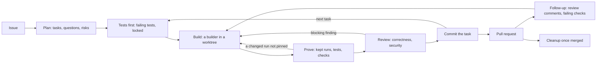

# Theseus

Theseus takes a GitHub or GitLab issue to a reviewed pull request inside Claude Code. It plans the issue as tasks,
has a test writer write each task's failing tests first, sends a builder to make them pass in a git worktree of its
own, proves every change against what the project actually does, and has reviewers judge it before it is committed.
You decide what gets built and when it is pushed; Theseus does the rest and shows you where each run stands.

It is named after the maze-solving mouse Claude Shannon built in 1950: a machine that found its way through a
labyrinth it did not know.

## Quickstart

You need Claude Code, git, and the CLI of your forge signed in (`gh auth login` for GitHub, `glab auth login` for
GitLab).

```sh
git clone https://github.com/lienardquentin/claude-code-shenanigans
claude plugin marketplace add ./claude-code-shenanigans/.claude/mods
claude plugin install theseus@theseus
```

Add `recorder@theseus` too if the project has a command-line tool to prove: it keeps the runs Theseus compares.

Then, in Claude Code, in your repository:

```
/theseus doctor          # what Theseus needs here, and the one command that fixes each miss
/theseus init            # proposes .claude/theseus.toml from your project; --write writes it
/theseus build errand 12 # builds issue #12 in one change, in a worktree, and waits for your go
```

A larger issue is planned first: `/theseus plan 12`, answer the plan's questions in its pane, then `/theseus build`
(`--auto` goes on by itself through every task and opens the pull request).

## How a run goes



- **Plan.** The planner reads the issue and the code, and writes tasks, each with its files, steps and what "done"
  means; the questions only you can answer; and the risks. Nothing is built while a question is open, unless the run
  is `--auto`, which decides them itself and lists each under "Decided without the person" in the plan and the pull
  request.
- **Tests first.** For each task that is not light, a test writer writes the failing tests of what is to come, runs
  them to show they fail, and they are locked: a builder that changes one must say why.
- **Build.** A builder sized to the task makes the tests pass in the run's worktree: Haiku for a light task, Sonnet
  knowing the target's kind for a standard one, Opus for a heavy one. Each retry goes a rung up, Opus at high effort
  last. Tasks that share no file are built side by side in lanes.
- **Prove.** Theseus plays the runs and requests the project keeps on the commit and on the change, and lists each
  answer that changed. A changed answer must be pinned by an integration test (a `pins:` comment above it), the
  project's tests a change can break must still pass, and its checks may not newly fail.
- **Review.** Reviewers (`/code-review`, `/security-review` by default) judge the proved change against the project's
  written standards. A blocking finding sends the builder back.
- **Commit and submit.** Each task is committed on the run's branch. The branch is pushed and the pull request opened
  on your `/theseus build submit`, or by itself on an `--auto` run.

## Commands

| Command | What it does |
|---|---|
| `/theseus` | What is under way, and what failed this session. |
| `/theseus plan <issue \| idea>` | Plans an issue (`--again` plans afresh). An idea is a sentence: Claude grills you on it, opens its issue and plans it (`--auto` asks nothing). Alone, opens the plan. |
| `/theseus build` | Builds the plan in force in a worktree (`--auto` goes on by itself). Alone, lists the runs under way. |
| `/theseus build errand <issue>` | Builds a small issue in one change, with no plan. |
| `/theseus build next \| commit \| submit \| halt \| abandon [run]` | Sends the next task, commits after a fix, pushes and opens the pull request, stops after the current task, or abandons a run (its worktree and branch removed). |
| `/theseus tests <behaviour>` | Has the test writer write the failing tests of a behaviour first. |
| `/theseus verify` | The proof of the uncommitted change, target by target. |
| `/theseus follow-up <pr>` | Reads a pull request's review comments and failing checks; `answer` hands those that ask for a change to the build, questions stay yours. |
| `/theseus cleanup [clean]` | What is kept of merged pull requests; `clean` removes the worktree and branch. |
| `/theseus issues` | The open issues, each one an errand or a plan away. |
| `/theseus doctor` | What Theseus needs on this machine and in this project, and how to fix each miss. |
| `/theseus init [--write]` | Proposes `.claude/theseus.toml` from the project. |
| `/theseus help` | Every verb. |

Each command opens its pane. Claude reads any pane with the `mcp__theseus__pane` tool, so you can ask about what a
pane shows.

## Configuration

**The project**: `.claude/theseus.toml` names what the project builds and how each part is tested, checked and
reviewed. [docs/config.md](../../../docs/config.md) describes every key. Without it, a change is proved by the
verification commands its plan states, or its issue's `## Verification` section.

**The plugin's options** (`/plugin`, then Theseus):

| Option | Default | What it does |
|---|---|---|
| 5-hour quota threshold | 90% | Past it, a run starts no task: it waits, and goes on by itself once the window resets. |
| Weekly quota threshold | 90% | Past it, a run stops for you: the window is days from resetting. |
| Builder context budget | 70% | A builder that fills this much of a 200k-token window is stopped, and its task said to be too large, to be split. |

## What it writes, and where

| Where | What |
|---|---|
| `.theseus/trees/<branch>/` | A run's git worktree. Your own checkout is never switched. |
| `.theseus/plans/` | The planner's plans while it writes them. |
| `.theseus/verify/trees/` | Throwaway checkouts the proof plays the commit in. |
| `.theseus/spend.jsonl` | What each run's agents spent, a turn a line. |
| `build/<issue>-<title>` | A run's branch, pushed only on submit. |
| `~/.claude/plugins/store/theseus_*.json` | The plans and runs, kept across sessions. |

`.theseus/` ignores itself (it holds a `.gitignore` of `*`), so nothing of it is committed. `/theseus cleanup clean`
removes a merged run's worktree and branch. Uninstalling the plugin leaves `.theseus/` in each project and its store
file: delete them by hand if you no longer want them.

## Troubleshooting

**A run will not start.** `/theseus doctor` says what is missing and the command that fixes it: a forge CLI not
signed in, a program a target's command needs, Docker not running, an error in `.claude/theseus.toml`.

**It seems stuck.** `/theseus` alone lists what failed this session; ask Claude to read the `troubles` pane for the
details. A run waiting on the quota says so in the build pane, with when it goes on.

**Theseus says an installed copy lags.** The plugin you run is older than its source. `claude plugin update
theseus@theseus`, then restart Claude Code. An update only takes a new version: each release bumps it.

**The panes and tools act on the wrong folder.** Theseus works in the folder Claude Code started in. A `cd` in a shell
command moves the session's directory: start Claude Code again in the repository.

**A command is refused by the host.** Claude Code refuses a plugin command that has the name of a built-in one; every
Theseus command is under `/theseus`.

## Words it uses

- **Run**: the build of one plan, errand or review, on a branch of its own.
- **Task**: one step of a plan, built and committed alone.
- **Errand**: an issue small enough to build in one change, with no plan.
- **Lane**: a task built beside others, in a worktree of its own, because it shares no file with them.
- **Kept run**: a command-line run (kept by the recorder) or a service request (named in `.claude/theseus.toml`) that
  the proof plays on the commit and on the change.
- **Pinned**: a changed kept run that an integration test makes and asserts, marked `pins: <the run>` above it.
- **Settled**: a change whose every changed run is pinned, whose tests pass and whose checks do not newly fail.

## Development

```sh
claude plugin validate .            # the manifest, and the hooks' rules
claude plugin test .                # the tests
sh ../kit/check-versions.sh main    # each changed plugin bumped its version
sh ../kit/write-schema.sh --check   # the JSON Schema matches core/schema.ts
```

The workflow lives in `core/`, which never touches the engine; the hooks under `hooks/` adapt it to Claude Code. Each
change bumps `version` in `.claude-plugin/plugin.json` and says what it changes in `CHANGELOG.md`.

## License

MIT, see [LICENSE](../LICENSE).
